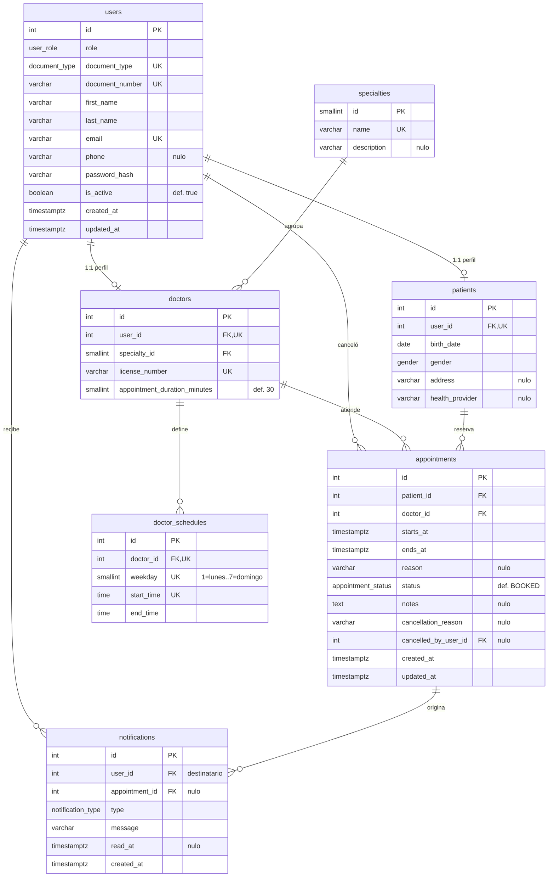

# 03 — Modelo de datos

Motor: **PostgreSQL 16**. Esquema `public`, codificación `UTF8`.
Convención: `snake_case` en minúsculas, tablas en plural, llave primaria `id`, llaves foráneas
`<tabla_singular>_id` — conforme al documento de estándares de codificación.

---

## 1. Qué cambió respecto al modelo entregado

| Cambio | Antes (`docs/`) | Ahora | Por qué |
|---|---|---|---|
| Motor | MySQL 8.0 | PostgreSQL 16 | Decisión 1 |
| Idioma | Español | Inglés | Decisión 4 |
| Tabla `roles` | Tabla + FK + CHECK | Tipo `ENUM` `user_role` | Tres valores fijos; elimina una tabla y un `JOIN` |
| Tabla `consultorios` | Existía | Eliminada | Fuera del alcance |
| **Solapamiento de citas** | `UNIQUE(id_medico, fecha_inicio)` | `EXCLUDE USING gist` con rangos | La `UNIQUE` **no impedía solapamientos parciales** ni protegía al paciente, y **bloqueaba la reutilización del cupo tras cancelar**. Ver [00, D1–D3](00-hallazgos-y-preguntas.md) |
| `notifications` | FK obligatoria a `citas` | FK a `users` (destinatario) + FK anulable a `appointments` | El manual describe avisos sin cita asociada |
| Observaciones clínicas | No existía | `appointments.notes` | El manual las describe como funcionalidad |
| Motivo de cancelación | No existía | `appointments.cancellation_reason` y `cancelled_by_user_id` | El manual lo pide y el reporte lo necesita |
| Marcas de tiempo | `DATETIME` sin zona | `TIMESTAMPTZ` | Evita ambigüedad de zona horaria |
| Auditoría | Solo `fecha_creacion` | `created_at` y `updated_at` en las tablas mutables | Lo exige el estándar de codificación |

---

## 2. Entidades

### 2.1 Diagrama entidad-relación



> Las dos restricciones `EXCLUDE` sobre `appointments` no se pueden dibujar en un diagrama
> entidad-relación, porque no son ni llaves ni cardinalidades: son reglas sobre rangos de
> tiempo. Están en §5.2, y son lo más importante del modelo.

### 2.2 Resumen de tablas

| Tabla | Propósito | Crecimiento |
|---|---|---|
| `users` | Credenciales y datos comunes de toda persona del sistema | Alto |
| `specialties` | Catálogo de especialidades médicas | Nulo (semilla) |
| `patients` | Datos propios del paciente. Extiende `users` 1:1 | Alto |
| `doctors` | Datos propios del médico. Extiende `users` 1:1 | Bajo |
| `doctor_schedules` | Franjas de atención recurrentes por día de la semana | Bajo |
| `appointments` | Tabla central: cada cita y su ciclo de vida | Muy alto |
| `notifications` | Avisos dirigidos a un usuario | Muy alto |

---

## 3. Tipos enumerados

| Tipo | Valores | Uso |
|---|---|---|
| `user_role` | `PATIENT`, `DOCTOR`, `ADMIN` | `users.role` |
| `document_type` | `CC`, `TI`, `CE`, `PA` | `users.document_type` |
| `gender` | `FEMALE`, `MALE`, `OTHER` | `patients.gender` |
| `appointment_status` | `BOOKED`, `CONFIRMED`, `COMPLETED`, `CANCELLED` | `appointments.status` |
| `notification_type` | `APPOINTMENT_BOOKED`, `APPOINTMENT_CONFIRMED`, `APPOINTMENT_CANCELLED`, `APPOINTMENT_COMPLETED`, `ACCOUNT_CREATED` | `notifications.type` |

---

## 4. Diccionario de datos

### 4.1 `users`

| Columna | Tipo | Nulo | Restricción | Descripción |
|---|---|---|---|---|
| `id` | `SERIAL` | No | PK | Identificador |
| `role` | `user_role` | No | | Perfil de acceso |
| `document_type` | `document_type` | No | UQ* | Tipo de documento |
| `document_number` | `VARCHAR(20)` | No | UQ* | Número de documento |
| `first_name` | `VARCHAR(60)` | No | | Nombres |
| `last_name` | `VARCHAR(60)` | No | | Apellidos |
| `email` | `VARCHAR(150)` | No | UQ, CHECK formato | Correo de ingreso |
| `phone` | `VARCHAR(15)` | Sí | | Teléfono de contacto |
| `password_hash` | `VARCHAR(255)` | No | | Hash bcrypt. Nunca sale de la capa de datos |
| `is_active` | `BOOLEAN` | No | DEFAULT `TRUE` | Cuenta habilitada |
| `created_at` | `TIMESTAMPTZ` | No | DEFAULT `now()` | |
| `updated_at` | `TIMESTAMPTZ` | No | DEFAULT `now()` | |

\* UQ compuesta sobre (`document_type`, `document_number`).

### 4.2 `specialties`

| Columna | Tipo | Nulo | Restricción | Descripción |
|---|---|---|---|---|
| `id` | `SMALLSERIAL` | No | PK | |
| `name` | `VARCHAR(80)` | No | UQ | Nombre de la especialidad |
| `description` | `VARCHAR(255)` | Sí | | Descripción breve |

### 4.3 `patients`

| Columna | Tipo | Nulo | Restricción | Descripción |
|---|---|---|---|---|
| `id` | `SERIAL` | No | PK | |
| `user_id` | `INT` | No | FK → `users`, UQ, ON DELETE CASCADE | Cuenta asociada |
| `birth_date` | `DATE` | No | CHECK entre 1900-01-01 y hoy | Fecha de nacimiento |
| `gender` | `gender` | No | | Género |
| `address` | `VARCHAR(120)` | Sí | | Dirección |
| `health_provider` | `VARCHAR(80)` | Sí | | EPS |

### 4.4 `doctors`

| Columna | Tipo | Nulo | Restricción | Descripción |
|---|---|---|---|---|
| `id` | `SERIAL` | No | PK | |
| `user_id` | `INT` | No | FK → `users`, UQ, ON DELETE CASCADE | Cuenta asociada |
| `specialty_id` | `SMALLINT` | No | FK → `specialties`, ON DELETE RESTRICT | Especialidad |
| `license_number` | `VARCHAR(30)` | No | UQ | Registro médico profesional |
| `appointment_duration_minutes` | `SMALLINT` | No | DEFAULT 30, CHECK 10–120 | Duración de cada consulta |

### 4.5 `doctor_schedules`

| Columna | Tipo | Nulo | Restricción | Descripción |
|---|---|---|---|---|
| `id` | `SERIAL` | No | PK | |
| `doctor_id` | `INT` | No | FK → `doctors`, ON DELETE CASCADE, UQ* | Médico |
| `weekday` | `SMALLINT` | No | CHECK 1–7, UQ* | 1 = lunes … 7 = domingo |
| `start_time` | `TIME` | No | UQ* | Inicio de la franja, hora local |
| `end_time` | `TIME` | No | CHECK > `start_time` | Fin de la franja, hora local |

\* UQ compuesta sobre (`doctor_id`, `weekday`, `start_time`). El no solapamiento entre franjas
(RN-12) se valida en la aplicación; ver nota 5.2.

### 4.6 `appointments`

| Columna | Tipo | Nulo | Restricción | Descripción |
|---|---|---|---|---|
| `id` | `SERIAL` | No | PK | |
| `patient_id` | `INT` | No | FK → `patients`, ON DELETE RESTRICT | Paciente |
| `doctor_id` | `INT` | No | FK → `doctors`, ON DELETE RESTRICT | Médico |
| `starts_at` | `TIMESTAMPTZ` | No | | Inicio, en UTC |
| `ends_at` | `TIMESTAMPTZ` | No | CHECK > `starts_at` | Fin, calculado por el servidor |
| `reason` | `VARCHAR(255)` | Sí | | Motivo de la consulta |
| `status` | `appointment_status` | No | DEFAULT `'BOOKED'` | Estado |
| `notes` | `TEXT` | Sí | | Observaciones del médico al completar |
| `cancellation_reason` | `VARCHAR(255)` | Sí | CHECK condicionado | Motivo de cancelación |
| `cancelled_by_user_id` | `INT` | Sí | FK → `users`, ON DELETE SET NULL | Quién canceló |
| `created_at` | `TIMESTAMPTZ` | No | DEFAULT `now()` | |
| `updated_at` | `TIMESTAMPTZ` | No | DEFAULT `now()` | |

### 4.7 `notifications`

| Columna | Tipo | Nulo | Restricción | Descripción |
|---|---|---|---|---|
| `id` | `SERIAL` | No | PK | |
| `user_id` | `INT` | No | FK → `users`, ON DELETE CASCADE | **Destinatario** |
| `appointment_id` | `INT` | Sí | FK → `appointments`, ON DELETE CASCADE | Cita que originó el aviso, si la hay |
| `type` | `notification_type` | No | | Motivo del aviso |
| `message` | `VARCHAR(500)` | No | | Texto mostrado |
| `read_at` | `TIMESTAMPTZ` | Sí | | Momento en que se marcó como leída |
| `created_at` | `TIMESTAMPTZ` | No | DEFAULT `now()` | |

---

## 5. Restricciones de integridad

### 5.1 Integridad referencial

| Restricción | Relación | ON DELETE | Justificación |
|---|---|---|---|
| `patients_user_id_fkey` | `patients` → `users` | CASCADE | El perfil no existe sin la cuenta |
| `doctors_user_id_fkey` | `doctors` → `users` | CASCADE | Igual |
| `doctors_specialty_id_fkey` | `doctors` → `specialties` | RESTRICT | No se borra una especialidad con médicos |
| `doctor_schedules_doctor_id_fkey` | `doctor_schedules` → `doctors` | CASCADE | Los horarios no tienen sentido sin su médico |
| `appointments_patient_id_fkey` | `appointments` → `patients` | RESTRICT | Protege el historial |
| `appointments_doctor_id_fkey` | `appointments` → `doctors` | RESTRICT | Protege el historial |
| `appointments_cancelled_by_fkey` | `appointments` → `users` | SET NULL | La cita sobrevive a la cuenta que la canceló |
| `notifications_user_id_fkey` | `notifications` → `users` | CASCADE | Los avisos son del usuario |
| `notifications_appointment_id_fkey` | `notifications` → `appointments` | CASCADE | Si la cita desaparece, sus avisos también |

En la práctica nunca se borra un usuario (RN-08.3), así que las cascadas solo actúan en
desarrollo y en el reinicio de los datos semilla.

### 5.2 La restricción que importa: no solapamiento

Este es el punto donde el modelo entregado fallaba. PostgreSQL permite expresar la regla
correcta con una restricción de exclusión sobre rangos de tiempo:

```sql
CREATE EXTENSION IF NOT EXISTS btree_gist;

ALTER TABLE appointments
  ADD CONSTRAINT appointments_doctor_no_overlap
  EXCLUDE USING gist (
    doctor_id WITH =,
    tstzrange(starts_at, ends_at, '[)') WITH &&
  ) WHERE (status <> 'CANCELLED');

-- El paciente, además de no solaparse, necesita PATIENT_APPOINTMENT_GAP_MINUTES
-- libres entre una cita y otra (RN-21.7). Como la EXCLUDE compara los dos rangos
-- ya ampliados, cada fila se amplía la MITAD del margen a cada lado.
CREATE OR REPLACE FUNCTION appointment_patient_gap_range(starts_at timestamptz, ends_at timestamptz)
  RETURNS tstzrange LANGUAGE sql IMMUTABLE PARALLEL SAFE
AS $$
  SELECT tstzrange(starts_at - interval '30 minutes', ends_at + interval '30 minutes', '[)');
$$;

ALTER TABLE appointments
  ADD CONSTRAINT appointments_patient_min_gap
  EXCLUDE USING gist (
    patient_id WITH =,
    appointment_patient_gap_range(starts_at, ends_at) WITH &&
  ) WHERE (status <> 'CANCELLED');
```

La expresión de un índice debe ser `IMMUTABLE` y `timestamptz - interval` es `STABLE` —depende de
la zona horaria cuando el intervalo trae meses o días—, por eso el desplazamiento va dentro de una
función propia: con minutos fijos el resultado sí es invariable.

Tres propiedades que la `UNIQUE(doctor_id, starts_at)` del modelo original **no** tenía:

1. **Detecta el solapamiento parcial.** Una cita 08:00–08:30 y otra 08:15–08:45 chocan, y el
   motor las rechaza. Con la `UNIQUE` original pasaban ambas.
2. **Ignora las citas canceladas** gracias a la cláusula `WHERE`. El cupo vuelve a quedar libre
   al cancelar, que es justo lo que promete el manual de usuario y lo que la `UNIQUE` original
   impedía.
3. **Protege también al paciente.** Nadie puede tener dos citas simultáneas con médicos
   distintos, ni dos citas a menos de una hora de distancia (RN-21.7).

El rango `'[)'` incluye el inicio y excluye el fin, de modo que una cita de 08:00–08:30 y otra
de 08:30–09:00 son consecutivas, no solapadas.

> **Nota sobre Prisma.** Las restricciones `EXCLUDE` no se pueden declarar en `schema.prisma`.
> Se añaden con una migración SQL manual (`prisma migrate dev --create-only` y luego editar el
> archivo). El violation code de PostgreSQL es `23P01`, y la capa de datos lo traduce a
> `409 SLOT_TAKEN`, o a `409 PATIENT_APPOINTMENT_TOO_CLOSE` cuando el nombre de la restricción
> violada es `appointments_patient_min_gap`.

### 5.3 Restricciones de verificación

| Restricción | Tabla | Regla |
|---|---|---|
| `users_email_format` | `users` | El correo cumple `~* '^[^@\s]+@[^@\s]+\.[^@\s]+$'` |
| `patients_birth_date_range` | `patients` | Entre `1900-01-01` y `CURRENT_DATE` |
| `doctors_duration_range` | `doctors` | `appointment_duration_minutes` entre 10 y 120 |
| `doctor_schedules_weekday_range` | `doctor_schedules` | `weekday` entre 1 y 7 |
| `doctor_schedules_time_range` | `doctor_schedules` | `end_time > start_time` |
| `appointments_time_range` | `appointments` | `ends_at > starts_at` |
| `appointments_cancellation_consistency` | `appointments` | Si `status = 'CANCELLED'` entonces `cancellation_reason IS NOT NULL`; si no, es `NULL` |

La última restricción es la que impide que el sistema quede en un estado incoherente: una cita
cancelada sin motivo, o una cita activa que arrastra un motivo de cancelación viejo.

> **Límites que no están en el motor.** `appointments.notes` es `TEXT` sin longitud máxima en la
> base de datos, pero RN-27 la limita a 2000 caracteres. Ese límite lo aplica el esquema Zod, no
> un `CHECK`: es una restricción de interfaz —evitar que alguien pegue un documento entero— y no
> una regla de integridad. Todas las demás longitudes sí están en el motor, con `VARCHAR(n)`.

### 5.4 Índices

Además de los que PostgreSQL crea por PK, UNIQUE y EXCLUDE:

| Índice | Columnas | Consulta que acelera |
|---|---|---|
| `idx_appointments_patient_starts_at` | (`patient_id`, `starts_at` DESC) | "Mis citas" del paciente |
| `idx_appointments_doctor_starts_at` | (`doctor_id`, `starts_at`) | Agenda del médico y cálculo de cupos |
| `idx_appointments_status` | (`status`) | Indicadores del panel administrativo |
| `idx_notifications_user_unread` | (`user_id`, `read_at`) | Contador de la campana |
| `idx_users_role_active` | (`role`, `is_active`) | Listado de usuarios del administrador |

---

## 6. Script DDL completo

```sql
-- =====================================================================
-- MediCitas — Esquema de base de datos
-- Motor: PostgreSQL 16
-- =====================================================================

CREATE EXTENSION IF NOT EXISTS btree_gist;

-- ---------------------------------------------------------------------
-- Tipos enumerados
-- ---------------------------------------------------------------------
CREATE TYPE user_role          AS ENUM ('PATIENT', 'DOCTOR', 'ADMIN');
CREATE TYPE document_type      AS ENUM ('CC', 'TI', 'CE', 'PA');
CREATE TYPE gender             AS ENUM ('FEMALE', 'MALE', 'OTHER');
CREATE TYPE appointment_status AS ENUM ('BOOKED', 'CONFIRMED', 'COMPLETED', 'CANCELLED');
CREATE TYPE notification_type  AS ENUM (
  'APPOINTMENT_BOOKED',
  'APPOINTMENT_CONFIRMED',
  'APPOINTMENT_CANCELLED',
  'APPOINTMENT_COMPLETED',
  'ACCOUNT_CREATED'
);

-- ---------------------------------------------------------------------
-- users
-- ---------------------------------------------------------------------
CREATE TABLE users (
  id               SERIAL        PRIMARY KEY,
  role             user_role     NOT NULL,
  document_type    document_type NOT NULL,
  document_number  VARCHAR(20)   NOT NULL,
  first_name       VARCHAR(60)   NOT NULL,
  last_name        VARCHAR(60)   NOT NULL,
  email            VARCHAR(150)  NOT NULL,
  phone            VARCHAR(15),
  password_hash    VARCHAR(255)  NOT NULL,
  is_active        BOOLEAN       NOT NULL DEFAULT TRUE,
  created_at       TIMESTAMPTZ   NOT NULL DEFAULT now(),
  updated_at       TIMESTAMPTZ   NOT NULL DEFAULT now(),

  CONSTRAINT users_email_unique     UNIQUE (email),
  CONSTRAINT users_document_unique  UNIQUE (document_type, document_number),
  CONSTRAINT users_email_format     CHECK (email ~* '^[^@\s]+@[^@\s]+\.[^@\s]+$')
);

CREATE INDEX idx_users_role_active ON users (role, is_active);

-- ---------------------------------------------------------------------
-- specialties
-- ---------------------------------------------------------------------
CREATE TABLE specialties (
  id           SMALLSERIAL  PRIMARY KEY,
  name         VARCHAR(80)  NOT NULL,
  description  VARCHAR(255),

  CONSTRAINT specialties_name_unique UNIQUE (name)
);

-- ---------------------------------------------------------------------
-- patients
-- ---------------------------------------------------------------------
CREATE TABLE patients (
  id               SERIAL       PRIMARY KEY,
  user_id          INT          NOT NULL,
  birth_date       DATE         NOT NULL,
  gender           gender       NOT NULL,
  address          VARCHAR(120),
  health_provider  VARCHAR(80),

  CONSTRAINT patients_user_unique      UNIQUE (user_id),
  CONSTRAINT patients_birth_date_range CHECK (birth_date BETWEEN DATE '1900-01-01' AND CURRENT_DATE),
  CONSTRAINT patients_user_id_fkey     FOREIGN KEY (user_id)
    REFERENCES users (id) ON DELETE CASCADE
);

-- ---------------------------------------------------------------------
-- doctors
-- ---------------------------------------------------------------------
CREATE TABLE doctors (
  id                            SERIAL      PRIMARY KEY,
  user_id                       INT         NOT NULL,
  specialty_id                  SMALLINT    NOT NULL,
  license_number                VARCHAR(30) NOT NULL,
  appointment_duration_minutes  SMALLINT    NOT NULL DEFAULT 30,

  CONSTRAINT doctors_user_unique        UNIQUE (user_id),
  CONSTRAINT doctors_license_unique     UNIQUE (license_number),
  CONSTRAINT doctors_duration_range     CHECK (appointment_duration_minutes BETWEEN 10 AND 120),
  CONSTRAINT doctors_user_id_fkey       FOREIGN KEY (user_id)
    REFERENCES users (id) ON DELETE CASCADE,
  CONSTRAINT doctors_specialty_id_fkey  FOREIGN KEY (specialty_id)
    REFERENCES specialties (id) ON DELETE RESTRICT
);

-- ---------------------------------------------------------------------
-- doctor_schedules
-- ---------------------------------------------------------------------
CREATE TABLE doctor_schedules (
  id          SERIAL   PRIMARY KEY,
  doctor_id   INT      NOT NULL,
  weekday     SMALLINT NOT NULL,          -- 1 = lunes ... 7 = domingo (ISO-8601)
  start_time  TIME     NOT NULL,
  end_time    TIME     NOT NULL,

  CONSTRAINT doctor_schedules_slot_unique    UNIQUE (doctor_id, weekday, start_time),
  CONSTRAINT doctor_schedules_weekday_range  CHECK (weekday BETWEEN 1 AND 7),
  CONSTRAINT doctor_schedules_time_range     CHECK (end_time > start_time),
  CONSTRAINT doctor_schedules_doctor_id_fkey FOREIGN KEY (doctor_id)
    REFERENCES doctors (id) ON DELETE CASCADE
);

-- ---------------------------------------------------------------------
-- appointments
-- ---------------------------------------------------------------------
CREATE TABLE appointments (
  id                    SERIAL             PRIMARY KEY,
  patient_id            INT                NOT NULL,
  doctor_id             INT                NOT NULL,
  starts_at             TIMESTAMPTZ        NOT NULL,
  ends_at               TIMESTAMPTZ        NOT NULL,
  reason                VARCHAR(255),
  status                appointment_status NOT NULL DEFAULT 'BOOKED',
  notes                 TEXT,
  cancellation_reason   VARCHAR(255),
  cancelled_by_user_id  INT,
  created_at            TIMESTAMPTZ        NOT NULL DEFAULT now(),
  updated_at            TIMESTAMPTZ        NOT NULL DEFAULT now(),

  CONSTRAINT appointments_time_range CHECK (ends_at > starts_at),

  -- Una cita cancelada tiene motivo; una que no lo está, no lo arrastra.
  CONSTRAINT appointments_cancellation_consistency CHECK (
    (status = 'CANCELLED' AND cancellation_reason IS NOT NULL) OR
    (status <> 'CANCELLED' AND cancellation_reason IS NULL)
  ),

  CONSTRAINT appointments_patient_id_fkey FOREIGN KEY (patient_id)
    REFERENCES patients (id) ON DELETE RESTRICT,
  CONSTRAINT appointments_doctor_id_fkey FOREIGN KEY (doctor_id)
    REFERENCES doctors (id) ON DELETE RESTRICT,
  CONSTRAINT appointments_cancelled_by_fkey FOREIGN KEY (cancelled_by_user_id)
    REFERENCES users (id) ON DELETE SET NULL
);

-- Ningún médico puede tener dos citas activas que se solapen (RN-22).
ALTER TABLE appointments
  ADD CONSTRAINT appointments_doctor_no_overlap
  EXCLUDE USING gist (
    doctor_id WITH =,
    tstzrange(starts_at, ends_at, '[)') WITH &&
  ) WHERE (status <> 'CANCELLED');

-- Ningún paciente puede tener dos citas activas que se solapen (RN-21.6).
ALTER TABLE appointments
  ADD CONSTRAINT appointments_patient_no_overlap
  EXCLUDE USING gist (
    patient_id WITH =,
    tstzrange(starts_at, ends_at, '[)') WITH &&
  ) WHERE (status <> 'CANCELLED');

CREATE INDEX idx_appointments_patient_starts_at ON appointments (patient_id, starts_at DESC);
CREATE INDEX idx_appointments_doctor_starts_at  ON appointments (doctor_id, starts_at);
CREATE INDEX idx_appointments_status            ON appointments (status);

-- ---------------------------------------------------------------------
-- notifications
-- ---------------------------------------------------------------------
CREATE TABLE notifications (
  id              SERIAL            PRIMARY KEY,
  user_id         INT               NOT NULL,
  appointment_id  INT,
  type            notification_type NOT NULL,
  message         VARCHAR(500)      NOT NULL,
  read_at         TIMESTAMPTZ,
  created_at      TIMESTAMPTZ       NOT NULL DEFAULT now(),

  CONSTRAINT notifications_user_id_fkey FOREIGN KEY (user_id)
    REFERENCES users (id) ON DELETE CASCADE,
  CONSTRAINT notifications_appointment_id_fkey FOREIGN KEY (appointment_id)
    REFERENCES appointments (id) ON DELETE CASCADE
);

CREATE INDEX idx_notifications_user_unread ON notifications (user_id, read_at);

-- ---------------------------------------------------------------------
-- Mantenimiento de updated_at
-- ---------------------------------------------------------------------
CREATE OR REPLACE FUNCTION set_updated_at() RETURNS TRIGGER AS $$
BEGIN
  NEW.updated_at := now();
  RETURN NEW;
END;
$$ LANGUAGE plpgsql;

CREATE TRIGGER users_set_updated_at
  BEFORE UPDATE ON users
  FOR EACH ROW EXECUTE FUNCTION set_updated_at();

CREATE TRIGGER appointments_set_updated_at
  BEFORE UPDATE ON appointments
  FOR EACH ROW EXECUTE FUNCTION set_updated_at();
```

---

## 7. Pruebas de validación de las restricciones

Estas son las pruebas que demuestran que el modelo cumple lo que promete. Se ejecutan como
parte de la suite (ver [08](08-pruebas-y-datos-semilla.md)).

| # | Operación intentada | Restricción | Resultado esperado |
|---|---|---|---|
| 1 | Registrar dos usuarios con el mismo correo | `users_email_unique` | `23505` clave duplicada |
| 2 | Registrar un correo sin formato válido | `users_email_format` | `23514` CHECK incumplida |
| 3 | Dos usuarios con el mismo tipo y número de documento | `users_document_unique` | `23505` |
| 4 | Dos citas del mismo médico a la **misma** hora | `appointments_doctor_no_overlap` | `23P01` exclusión |
| 5 | Cita 08:00–08:30 y otra **08:15**–08:45 del mismo médico | `appointments_doctor_no_overlap` | `23P01` — **el modelo original permitía esto** |
| 6 | Cita 08:00–08:30 y otra 08:30–09:00 del mismo médico | ninguna | **Aceptado**: son consecutivas, no solapadas |
| 7 | Reservar un cupo cuya cita anterior fue **cancelada** | ninguna | **Aceptado** — el modelo original lo bloqueaba |
| 8 | El mismo paciente con dos médicos a la misma hora | `appointments_patient_no_overlap` | `23P01` |
| 9 | Cita que termina antes de empezar | `appointments_time_range` | `23514` |
| 10 | Cancelar sin motivo | `appointments_cancellation_consistency` | `23514` |
| 11 | Estado `'MISSED'` | `appointment_status` | `22P02` valor no válido para el enum |
| 12 | Horario con `weekday = 8` | `doctor_schedules_weekday_range` | `23514` |
| 13 | Duración de consulta de 5 minutos | `doctors_duration_range` | `23514` |
| 14 | Borrar una especialidad que tiene médicos | `doctors_specialty_id_fkey` | `23503` |
| 15 | Borrar un paciente que tiene citas | `appointments_patient_id_fkey` | `23503` |

---

## 8. Mapeo español ↔ inglés

Para leer esta especificación junto a los documentos de `docs/`:

| Documento original | Esta especificación |
|---|---|
| `usuarios` | `users` |
| `roles` (tabla) | `user_role` (tipo enumerado) |
| `especialidades` | `specialties` |
| `pacientes` | `patients` |
| `medicos` | `doctors` |
| `horarios_medico` | `doctor_schedules` |
| `citas` | `appointments` |
| `notificaciones` | `notifications` |
| `consultorios` | *(eliminada)* |
| `fecha_inicio` / `fecha_fin` | `starts_at` / `ends_at` |
| `contrasena_hash` | `password_hash` |
| `estado` (usuario) | `is_active` |
| `estado` (cita) | `status` |
| `duracion_cita_min` | `appointment_duration_minutes` |
| `licencia_profesional` | `license_number` |
| `eps` | `health_provider` |
| `dia_semana` | `weekday` |
| `RESERVADA` / `CONFIRMADA` / `COMPLETADA` / `CANCELADA` | `BOOKED` / `CONFIRMED` / `COMPLETED` / `CANCELLED` |
